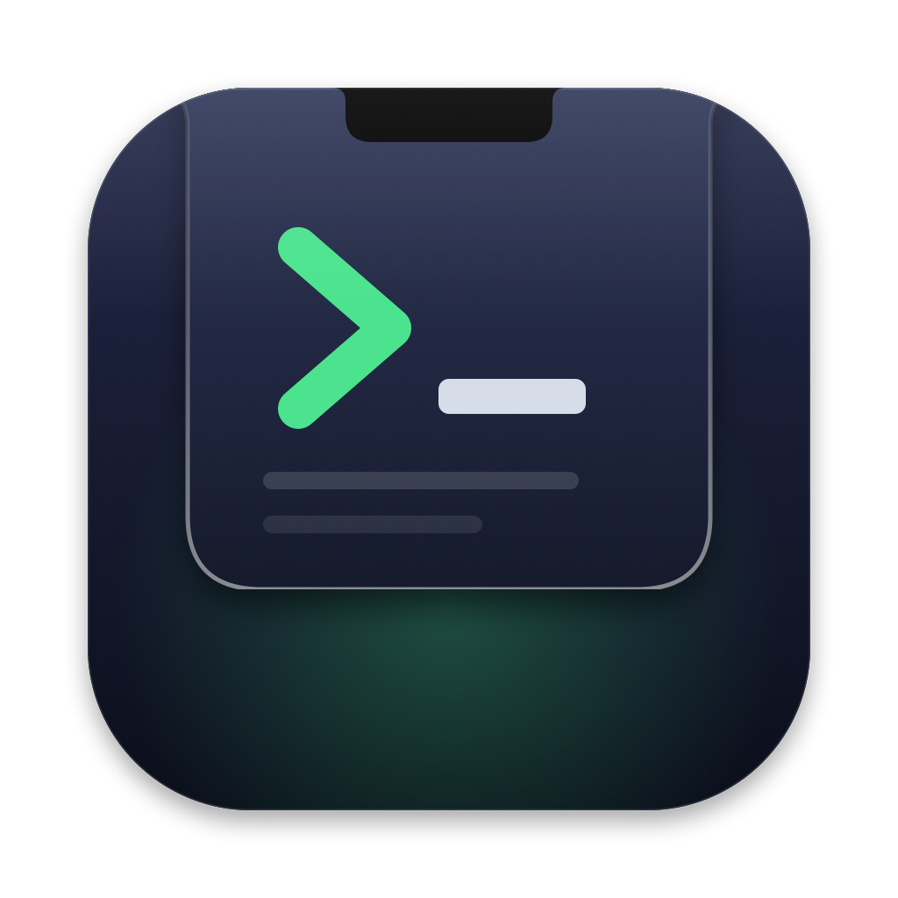

<p align="center"></p>

# NotchTerm

Terminale a tendina (stile Quake) per macOS che esce dal notch. Premi la scorciatoia e il notch
si allarga in un terminale vero; premila di nuovo e rientra.

## Installare

Con [Homebrew](https://brew.sh):

```bash
brew install --cask massan71/notchterm/notchterm
```

Oppure scarica `NotchTerm-x.y.z.zip` dalle [Release](https://github.com/massan71/NotchTerm/releases), estrai e sposta
`NotchTerm.app` in Applicazioni. L'app non è notarizzata: la prima volta macOS la blocca. Apri
Impostazioni di Sistema → Privacy e sicurezza → "Apri comunque", oppure da Terminale:

```bash
xattr -dr com.apple.quarantine /Applications/NotchTerm.app
```

## Compilare e avviare

Bastano i Command Line Tools (non serve Xcode):

```bash
make run        # compila e avvia build/NotchTerm.app
make install    # copia in /Applications e avvia
```

`build.sh` produce un'app universale (Apple Silicon + Intel); `ARCH=arm64 ./build.sh` compila solo una architettura.
`swift test` esegue i test (config, scorciatoie, forma del notch, schede e gli script di integrazione
con zsh, bash e fish avviati davvero); la CI li esegue a ogni push.

L'app vive nella barra dei menu (icona terminale) e non ha icona nel Dock.
Scorciatoia predefinita: **⌃`** (Control + backtick).

## Il notch

A terminale chiuso il notch reagisce:

- **mouse sopra** per un attimo (0,3 s) → il terminale scende;
- **clic** → il terminale scende;
- **trascini dei file** sopra → il terminale si apre per riceverli. Rilasciali sul testo per incollare i
  percorsi (già con gli spazi protetti), oppure sulla riga delle schede per aprire una nuova scheda in quella
  cartella.

Funziona anche trascinando direttamente sul terminale aperto. Si regola in Impostazioni → Generale → Notch
o con `notchZone` nel config. Sugli schermi senza notch la zona è al centro della barra dei menu.

**⌘clic** su un link o un percorso nel terminale lo apre (browser, Finder o l'app predefinita); con
l'integrazione con la shell i percorsi relativi partono dalla cartella della shell.

## Impostazioni

Menu nella barra → **Impostazioni…** (o ⌘, dentro il terminale). Quattro sezioni: Generale (scorciatoia
con registrazione dal vivo, schermo, comportamento, avvio al login), Aspetto (temi, materiale, font, forma),
Animazione (con pulsante di prova) e Shell. Le modifiche si applicano subito e vengono salvate in `config.json`,
scrivendo solo le voci cambiate.

## Liquid Glass

I temi `glass` e `glass-clear` usano il materiale Liquid Glass di macOS 26+ (`NSGlassEffectView`): il desktop
si vede attraverso il pannello, sfocato, con un bordo luminoso. Sulle versioni precedenti si ripiega su una
sfocatura classica. Il materiale si può usare anche con gli altri temi: `"material": "glass"`.

## Comandi in corso e avviso a fine comando

Lanci una build lunga e chiudi il terminale: dopo qualche secondo il notch si allarga appena ai lati e mostra
il tempo trascorso e un anello che gira (con più comandi in corso, anche quanti sono). Un clic lo riapre sulla
scheda del comando. Quando finisce, il notch si allarga con il comando, l'esito (✓ o ✗ con il codice d'uscita)
e la durata; un clic sull'avviso riapre il terminale su quella scheda. Se il terminale è aperto su un'altra
scheda, quella scheda mostra ✓ o ✗ nel titolo.

Per default l'indicatore compare dopo 3 secondi e l'avviso per i comandi che durano almeno 10 secondi; si
regola in Impostazioni → Shell o con `commandNotify` nel config. Editor, pager, `ssh`, `tmux` e simili sono
esclusi: l'elenco è `commandNotify.ignore`.

Funziona con **zsh**, **bash** (anche il bash 3.2 di macOS) e **fish** grazie a una piccola integrazione che
NotchTerm attiva da solo, senza toccare i tuoi file. Gli script stanno in
`~/Library/Application Support/NotchTerm/shell-integration`:

- **zsh** parte con `ZDOTDIR` puntato alla cartella di NotchTerm, il cui `.zshenv` ripristina subito il tuo
  `ZDOTDIR`, carica i tuoi file di avvio come sempre e aggiunge gli hook.
- **bash** parte con `--rcfile` su uno script che carica prima i tuoi file (`.bash_profile`/`.profile` per le
  shell di login, altrimenti `.bashrc`) e poi aggiunge gli hook a `PROMPT_COMMAND` e alla trap `DEBUG` (se
  usi già una trap `DEBUG`, per esempio bash-preexec, resta la tua e l'inizio del comando non viene segnalato).
- **fish** trova lo script in `XDG_DATA_DIRS` (`fish/vendor_conf.d`); lo script poi ripristina la variabile.

Si disattiva con `"shellIntegration": false`.

Con altre shell basta emettere a fine comando la sequenza
`ESC ] 7501 ; id=notchterm : state=done|error : title=<comando in base64> : msg=<"codice durata" in base64> BEL`
(e `state=working` all'inizio).

## Spotify e Apple Music

NotchTerm segue il brano in riproduzione su Spotify o Apple Music:

- **Mini-player** a destra del notch quando il terminale è aperto: copertina, titolo, artista e ⏮ ⏯ ⏭.
  Clic sul titolo per aprire il lettore.
- **Avviso al cambio brano**: a terminale chiuso il notch si allarga per qualche secondo con copertina e
  comandi, come la Dynamic Island. Con il mouse sopra resta aperto.

Il brano lo si legge dalle notifiche che i lettori già pubblicano, senza permessi. Per comandare la
riproduzione macOS chiede una volta il permesso di **Automazione**. NotchTerm non avvia mai il lettore.
Le copertine di Spotify arrivano dal servizio oEmbed pubblico di Spotify.
Tutto si regola in Impostazioni → Musica.

## Personalizzazione

Il file di configurazione è `~/.config/notchterm/config.json` (si apre dal menu, o con ⌘, dentro il terminale).
Si ricarica **da solo al salvataggio**. Basta scrivere le chiavi da cambiare, per le altre valgono i default.

| Chiave | Default | Descrizione |
|---|---|---|
| `hotkey` | `"ctrl+`"` | Es. `"option+space"`, `"cmd+shift+t"`, `"f12"` |
| `width`, `height` | `0.55`, `0.45` | ≤ 1 = frazione dello schermo, altrimenti pixel |
| `theme` | `"notch"` | `notch`, `glass`, `glass-clear`, `dracula`, `nord`, `gruvbox`, `tokyo-night`, `catppuccin`, `solarized-dark`, `paper` |
| `colors` | `{}` | Override: `background`, `foreground`, `cursor`, `selection`, `ansi` (16 colori `#RRGGBB`) |
| `material` | dal tema | `solid`, `blur`, `glass` (Liquid Glass), `glass-clear` |
| `opacity` | dal tema | Opacità della tinta di sfondo (0–1) |
| `borderOpacity` | dal tema | Intensità del bordo luminoso (0 = nessuno) |
| `font` | `{"name": "", "size": 13}` | Nome vuoto = SF Mono |
| `cursorStyle` | `"block-blink"` | `block`, `bar`, `underline`, con `-blink` opzionale |
| `cornerRadius` | `22` | Raggio degli angoli in basso |
| `earRadius` | `10` | Raccordi concavi in alto, come il notch hardware |
| `padding` | `14` | Margine attorno al testo |
| `animation` | `{"style": "spring", "duration": 0.42, "damping": 0.82}` | `spring`, `ease`, `none`; `damping` più basso = più rimbalzo |
| `hideOnFocusLoss` | `true` | Si chiude quando clicchi altrove |
| `screen` | `"notch"` | `notch`, `main`, `mouse` |
| `shell`, `shellArgs` | `$SHELL`, `["-l"]` | Shell da avviare |
| `workingDirectory` | `"~"` | Cartella iniziale |
| `env` | `{}` | Variabili d'ambiente aggiuntive |
| `restartShellOnExit` | `true` | Riavvia la shell dopo `exit` |
| `showHeader` | `true` | Titolo/cartella a sinistra del notch |
| `optionAsMeta` | `true` | Option come Meta (readline/emacs) |
| `newTabInheritsDirectory` | `true` | Le nuove schede si aprono nella cartella della scheda corrente |
| `maxTabWidth` | `170` | Larghezza massima di una linguetta |
| `media` | `{"enabled": true, "showInHeader": true, "peekOnTrackChange": true, "peekDuration": 4}` | Spotify / Apple Music |
| `notchZone` | `{"hoverToOpen": true, "hoverDelay": 0.3, "clickToOpen": true, "dropFiles": true}` | Il notch a terminale chiuso |
| `commandNotify` | `{"enabled": true, "minDuration": 10, "notifyOnSuccess": true, "liveIndicator": true, "liveIndicatorDelay": 3, "ignore": ["vim", "less", "ssh", …]}` | Indicatore dei comandi in corso e avviso a fine comando |
| `shellIntegration` | `true` | Integrazione zsh, bash e fish (serve a indicatore, avviso e cartella corrente) |
| `restoreTabs` | `true` | All'avvio riapre le schede nelle loro cartelle |
| `fallbackNotchWidth` | `190` | Larghezza del notch simulato sugli schermi senza notch |

Esempio:

```json
{
  "hotkey": "option+space",
  "theme": "tokyo-night",
  "width": 1000,
  "height": 0.5,
  "material": "glass",
  "opacity": 0.3,
  "font": { "name": "JetBrains Mono", "size": 14 },
  "animation": { "style": "spring", "damping": 0.65 }
}
```

## Schede

Le linguette stanno a sinistra del notch, il pulsante **+** a destra. Con una sola scheda si vede solo il titolo.
Clic per selezionare, × o clic centrale per chiudere.

| Scorciatoia | Azione |
|---|---|
| ⌘T | Nuova scheda (nella cartella corrente) |
| ⌘W | Chiudi scheda (sull'ultima: nasconde il pannello e riavvia la shell) |
| ⌘1 … ⌘8, ⌘9 | Vai alla scheda n / all'ultima |
| ⌃Tab, ⌃⇧Tab | Scheda successiva / precedente |
| ⌘⇧] ⌘⇧[ (o ⌘⇧→ ⌘⇧←) | Scheda successiva / precedente |
| ⌘⌥← / ⌘⌥→ | Sposta la scheda |

Quando la shell di una scheda termina (`exit`) la scheda si chiude; se era l'ultima, la shell riparte.

All'avvio NotchTerm riapre le schede della volta precedente, ognuna nella sua cartella (salvate in
`~/Library/Application Support/NotchTerm/tabs.json`; le cartelle sparite si saltano). Si disattiva con
`"restoreTabs": false` o da Impostazioni → Generale.

## Altre scorciatoie dentro il terminale

⌘F cerca nello storico (⌘G / ⌘⇧G successivo / precedente, Esc chiude) · ⌘C copia · ⌘V incolla · ⌘A seleziona tutto · ⌘K pulisci · ⌘+ / ⌘− / ⌘0 dimensione testo · ⌘, impostazioni

## Aprire da script

```bash
osascript -l JavaScript -e 'ObjC.import("Foundation"); $.NSDistributedNotificationCenter.defaultCenter.postNotificationNameObjectUserInfoDeliverImmediately("net.sangalli.notchterm.toggle", $(), $(), true)'
```

Sostituisci `toggle` con `newtab` per una nuova scheda, `settings` per le impostazioni o `peek` per mostrare l'avviso del brano. Utile per Raycast, Comandi Rapidi o skhd.

## Struttura

- `Sources/NotchTerm/NotchShape.swift` — forma del notch e misure del notch hardware
- `Sources/NotchTerm/NotchController.swift` — pannello, animazione, gestione schede e scorciatoie
- `Sources/NotchTerm/TerminalSession.swift` — una scheda: terminale SwiftTerm + shell
- `Sources/NotchTerm/TabBar.swift` — linguette nell'header
- `Sources/NotchTerm/Config.swift` — configurazione JSON e ricarica automatica
- `Sources/NotchTerm/Themes.swift` — temi inclusi e materiale di sfondo
- `Sources/NotchTerm/ShellIntegration.swift` — hook zsh, bash e fish: inizio/fine comando e cartella corrente
- `Sources/NotchTerm/ActivityIndicator.swift` — indicatore nel notch dei comandi in corso
- `Sources/NotchTerm/TabStore.swift` — schede salvate e ripristinate all'avvio
- `Sources/NotchTerm/NotchZone.swift` — il notch a terminale chiuso: mouse, clic, file trascinati
- `Sources/NotchTerm/NowPlaying.swift` — Spotify / Apple Music: stato, comandi, copertine
- `Sources/NotchTerm/MediaViews.swift` — mini-player e avvisi dal notch (brano, fine comando)
- `Sources/NotchTerm/Settings.swift` — finestra Impostazioni (SwiftUI)
- `Sources/NotchTerm/HotKey.swift` — scorciatoia globale (Carbon, nessun permesso richiesto)
- `Sources/NotchTerm/main.swift` — app e menu nella barra
- `Tests/NotchTermTests` — test (`swift test`)
- `scripts/make-icon.swift`, `scripts/make-icon.sh` — disegnano l'icona e generano `Resources/AppIcon.icns`

## Release

La CI (GitHub Actions, `.github/workflows/build.yml`) compila l'app universale a ogni push e allega lo zip
come artefatto. Per pubblicare una versione:

1. aggiorna `CFBundleShortVersionString` e `CFBundleVersion` in `Resources/Info.plist`;
2. fai commit e crea il tag corrispondente, es. `git tag -a v0.4.0 -m "NotchTerm 0.4.0"`;
3. `git push origin main v0.4.0`.

La CI controlla che il tag corrisponda alla versione, crea la release con zip e checksum e, se è impostato il
secret `TAP_TOKEN`, aggiorna il cask in [homebrew-notchterm](https://github.com/massan71/homebrew-notchterm).
In alternativa il cask si aggiorna a mano con `scripts/update-cask.sh <versione> <sha256>`.

## Requisiti

- macOS 13 o successivo (Liquid Glass richiede macOS 26+)
- Command Line Tools o Xcode con Swift 5.9+

## Licenza

[MIT](LICENSE) © 2026 Max Sangalli. Usa [SwiftTerm](https://github.com/migueldeicaza/SwiftTerm) (MIT) per l'emulazione del terminale.
